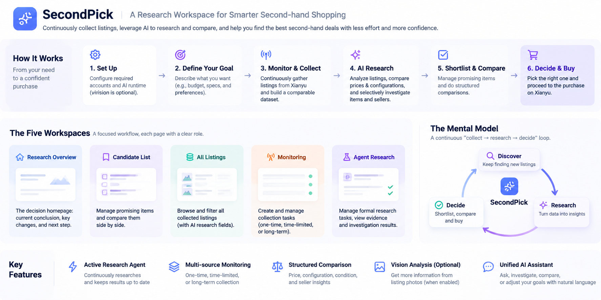
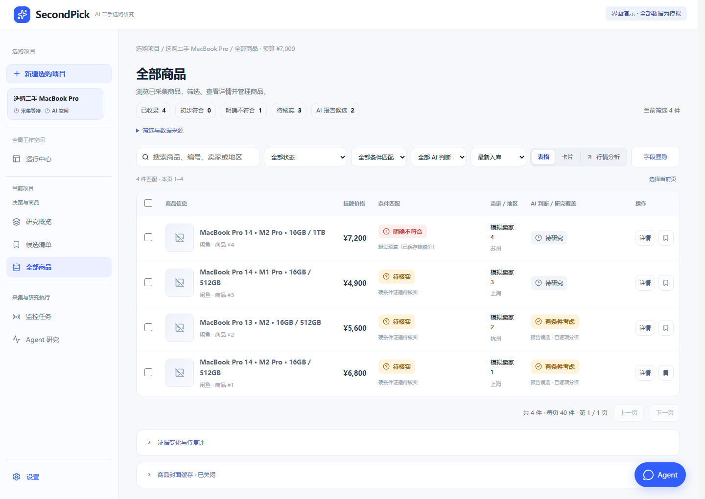
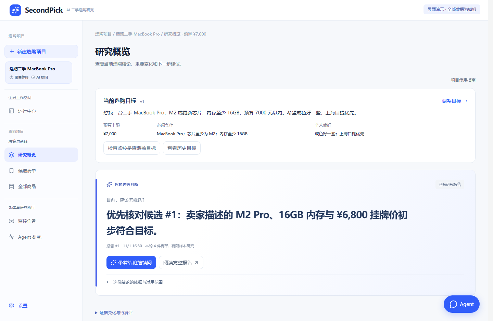
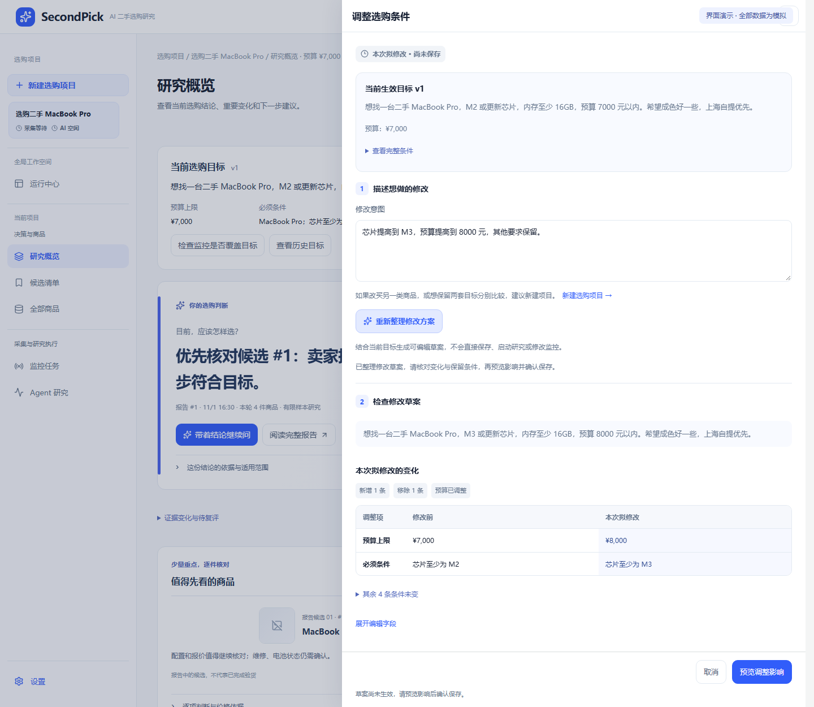

<div align="center">

# SecondPick

**Collect second-hand listings. Add AI research when you need it.**

Keep listings, evidence, and research history together on your own machine.

[简体中文](README.md) | **English**

[Two ways to use it](#two-ways-to-use-secondpick) · [How it works](#how-it-works) · [Quick start](#quick-start) · [Agent prompts](#agent-setup) · [Screenshots](#screenshots)

</div>

## Two ways to use SecondPick

| Your goal | How to use it |
| --- | --- |
| **Basic mode — collection only** | Collect once or monitor over time; browse, filter, and save listings yourself. No Codex CLI required. |
| **AI-enhanced mode** | Add Codex CLI and account authentication to research saved evidence against your requirements, compare candidates, and ask follow-up questions. |

**Collection and analysis can be used separately.** With automatic research disabled and no manual AI requests, the app does not call models to analyze listings. Collection still requires an engine environment and Xianyu login; AI drafting, research, and follow-up questions are configured when needed.

**Account authentication and research authorization serve different purposes.** CLI authentication connects the AI service. Automatic research requires separate authorization for each shopping project and is off by default. Completing AI-enhanced setup does not grant that authorization.

Vision is optional in both modes. A missing vision configuration or failed vision verification does not block onboarding. You can start in Basic mode and add AI later through **Settings → 使用引导 (Usage guide)**; switching modes does not start collection or research or change existing project permissions.

### Platform support

| Platform | Current status |
| --- | --- |
| Xianyu / Goofish | The main supported platform. Actual collection requires the project's specified monitoring engine, a compatible browser environment, and the user's login session. |
| JD | Complete, usable search and detail collection are not implemented. |
| Taobao | Complete, usable search and detail collection are not implemented. |
| Zhuanzhuan | Complete, usable search and detail collection are not implemented. |

Adapter interfaces, placeholder classes, and price-reference plans are not completed integrations. The Agent can analyze saved public seller information; a complete automatic seller-homepage collection and further investigation capability is not currently provided. Platform access remains subject to login, verification, and access restrictions.

## How it works

[](docs/images/readme-workflow-en.png)

- **Monitoring collects.** It gathers listings in scheduled rounds within a confirmed scope and saves them to All Listings, where you can filter them yourself.
- **The Agent researches.** It examines saved evidence against your shopping goal and produces candidate reasoning, uncertainties, and questions to verify. Research can be started manually or scheduled when its conditions are met.
- **The controls are separate.** Collection does not mean AI has already analyzed an item. Automatic research depends on authorization, pause state, and an eligible queue. Each report covers its own sample and goal.

> The illustration shows the full workflow; AI analysis is optional. **Xianyu is the main collection platform currently supported**—“multi-source” does not mean multiple marketplaces are integrated. A search match is not proof of suitability, and research findings still need verification.

### An example: shopping for a used laptop

> “I want a used MacBook Pro with an M2 or newer chip and at least 16 GB of RAM, for no more than ¥7,000. Local pickup in Shanghai would be a plus.”

For collection only, enter the project and search scope manually, enable monitoring, then browse saved records, filter prices, and save promising items.

When you want analysis, ask the Agent to examine those records against your requirements: which configurations deserve checking, what evidence is missing, and what to verify before buying. To consider M3 instead, preview and save a revised goal; check and confirm monitoring keywords separately.

## Quick start

<a id="agent-setup"></a>

### Recommended: Let your AI Agent deploy SecondPick

Use an **external AI Agent with local terminal and file access**. Copy this starter prompt; you do not need to prepare installation commands or a long parameter list:

```text
Help me deploy and run SecondPick on this computer.
Check the current working directory and usual project locations for an existing checkout.
Inspect and reuse it if found; otherwise obtain the project from
https://github.com/appodd/SecondPick.
Read README.en.md, docs/agent-prompts.md, docs/user-guide.md, and docs/DEVELOPMENT.md.
Follow the docs to inspect the environment, plan and install required dependencies,
start the workspace, and guide me through onboarding. Ask whether I want Basic
collection or AI-enhanced mode, then prepare the chosen capabilities; vision is optional.
For AI, first check whether existing Codex CLI and authentication are usable by the
SecondPick service. Reuse them when compatible; do not reinstall or request login again.
If they are unsuitable, explain the additional configuration needed.
Preserve existing data and configuration. I will handle account login myself.
Explain the scope and obtain the appropriate confirmation before real collection,
persistent configuration changes, or automatic research authorization.
Report the URL, actual checks performed, and remaining steps for me.
```

See [Agent deployment and usage prompts](docs/agent-prompts.md#english-templates) for first-time deployment, updating an existing installation, and daily use. English and Chinese templates are included.

These are two different Agents: the **external AI Agent** helps deploy, launch, and operate SecondPick; **SecondPick's internal AI Runtime** researches products and currently uses Codex CLI for text research. Deployment by an external Agent does not configure the internal research runtime automatically. Basic monitoring and collection need no Codex CLI. For research, configure it and account authentication according to the project requirements, and separately confirm each project's automatic research authorization.

### Option 2: Deploy and configure manually

Use this path if you do not have a local Agent or prefer to manage the environment yourself.

#### Requirements

| Component | Requirement |
| --- | --- |
| Primarily validated environment | Windows 10/11 with PowerShell |
| Python | Python 3.12 recommended |
| Browser | Playwright Chromium for app browser flows; the separate engine also checks system Chrome |
| Node.js | Not needed to launch the included frontend build; needed for frontend development |
| AI runtime | Codex CLI and authentication only for AI drafting, research, or follow-up questions |
| Vision model | Optional in both modes; not required for onboarding or text research |

Compatibility note: [pyproject.toml](pyproject.toml) declares Python 3.9+ for the app; the [separate engine setup script](scripts/setup_monitor.py) requires 3.11+. On Windows, Python 3.12 uses the provided [locked dependencies](requirements/monitor-engine-windows-py312.lock.txt). Other versions still need successful dependency installation and engine checks; they are not all validated environments.

#### 1. Launch the workspace

```powershell
git clone --branch main https://github.com/appodd/SecondPick.git
Set-Location SecondPick

python -m venv .venv
.\.venv\Scripts\Activate.ps1
python -m pip install -e .

shopping-agent-web
```

Open [http://127.0.0.1:8765](http://127.0.0.1:8765) to view the workspace and onboarding. This minimal launch path needs neither CLI nor vision dependencies; it does not prepare real collection yet.

#### 2. Prepare collection and complete Basic setup

In the activated virtual environment, install Chromium for the app's login browser:

```powershell
python -m playwright install chromium
```

Real monitoring also needs a [separate collection engine (Chinese guide)](docs/user-guide.md#准备独立采集环境), its dependency and system Chrome checks, and the correct local service configuration. Choose **Basic mode** in onboarding, pass the application, collection-environment, and Xianyu connection checks, then select **完成基础配置并开始使用**.

Log in to Xianyu yourself: **keep the opened browser running, return to the app to verify the connection, and close the browser only after verification.**

#### 3. Create your first shopping project

Enter the goal, budget, requirements, and preferences manually. Configure the keywords, monitoring mode, and per-round scope; preview and confirm before starting collection. Browse, filter, and save records in All Listings. Collection-only use requires neither CLI nor automatic research authorization. See the [collection-only guide (Chinese)](docs/user-guide.md#只抓取的使用方式).

A fresh installation has no preloaded projects, listings, or reports.

#### Optional: AI and image capabilities

For AI drafting, text research, or follow-up questions, configure Codex CLI and account authentication. Reopen **Settings → 使用引导 (Usage guide)**, select **AI-enhanced mode**, pass the additional checks, and select **完成 AI 增强配置并开始使用**. Automatic research still requires separate authorization for each project and is off by default. Completing onboarding does not start collection or research.

For vision analysis, install the optional extra from the repository root in the activated project environment, then configure, verify, and optionally enable the service under Vision Models:

```powershell
python -m pip install -e ".[vision]"
```

The extra includes `httpx` and `Pillow`. Cached listing images also use Pillow for decoding and validation; if you only need that image-processing capability, install `python -m pip install "Pillow>=10.0.0"` without configuring a vision model. Collecting listing records and browsing text fields do not require these extras.

Vision is optional in both onboarding paths. Revisiting setup preserves existing projects, listings, and research history.

## Inside the workspace

| Page | Main purpose |
| --- | --- |
| **Monitoring** | Confirm search scope, manage collection plans, and inspect execution status and history. |
| **All Listings** | Browse, search, and filter collected records; inspect asking prices and saved evidence. |
| **Candidate List** | Focus on research candidates and your own saved items for further comparison. |
| **Agent Research** | Start research, ask follow-up questions, and inspect results, evidence, and task history. |
| **Research Overview** | Review the current goal, saved findings, important changes, and next steps. |

Projects support **versioned goals**: describe a change, review an AI draft or edit manually, preview its impact, and confirm before saving. Existing listings, saved items, and research history remain available; monitoring scope does not silently change. Create a separate project when switching product categories or comparing two goals in parallel.

**Optional image research** can help examine approved image evidence. Keep seller claims, visual observations, and independent verification distinct. Detailed operations are covered in the [user guide (Chinese)](docs/user-guide.md).

## Screenshots

> These show the actual frontend using entirely synthetic projects, listings, sellers, prices, and findings—not real purchase recommendations. A fresh installation contains no preloaded data. Screenshots show the Chinese interface; this English README does not imply an English UI is available.

### All Listings: records and judgments in one view

Asking prices, requirement matching, research status, and save controls are shown together. Collection-only users can browse and filter their records here too.



### Research Overview: the goal, findings, and next step

See the current shopping goal and saved findings, then return to the report and listing evidence to check their sample and scope.



### Goal editing: change request → draft → review the differences

Move from M2 to M3, raise the budget, or add a preference. Review the differences before saving. Generating a draft does not directly change the goal or monitoring plan.



## Development and technology

The frontend uses **React / TypeScript / Vite**; the local backend uses **Python / FastAPI / SQLite**. Collection uses **Playwright and a separate engine adapter**. AI research is driven by **Codex CLI**, with an optional vision-model service.

### Modify or rebuild the frontend

Install Node.js and npm versions compatible with the lockfile dependencies, then run:

```powershell
npm --prefix web ci
npm --prefix web run build
```

See the [development guide (Chinese)](docs/DEVELOPMENT.md) for source layout, tests, and isolated runs.

## Data and usage boundaries

- **Stored locally, sent to AI when needed:** projects, evidence, research history, and login profiles are kept on your machine. AI requests send relevant goals and evidence to your configured model service; approved images may also be sent. See [privacy boundaries (Chinese)](docs/PRIVACY.md).
- **Runtime data stays outside the repository:** databases, login profiles, keys, and real business screenshots are not distributed with the source. Keep existing data directories when upgrading, and do not run multiple app instances against the same database.
- **Users handle transactions themselves:** Xianyu access is unofficial. Stop and follow the platform's normal process if verification, expired login sessions, or access restrictions occur. The app does not automatically message sellers, negotiate, place orders, or pay. See [account risks (Chinese)](docs/account-risk.md).

This is a **development snapshot**. Full backend regression and independent installation checks have passed in the specified environment; see the [validation record (Chinese)](docs/VALIDATION.md) for results and skip reasons. Real platform collection, external model quality, long-running stability, and other environments require separate validation.

## License

SecondPick is licensed under the [MIT License](LICENSE). Third-party dependencies and derived code remain subject to their respective licenses; see [THIRD_PARTY_NOTICES.md](THIRD_PARTY_NOTICES.md).

---

[中文 README](README.md) · [Documentation (Chinese)](docs/README.md) · [User guide (Chinese)](docs/user-guide.md) · [Development (Chinese)](docs/DEVELOPMENT.md) · [Privacy (Chinese)](docs/PRIVACY.md) · [Third-party notices](THIRD_PARTY_NOTICES.md)
