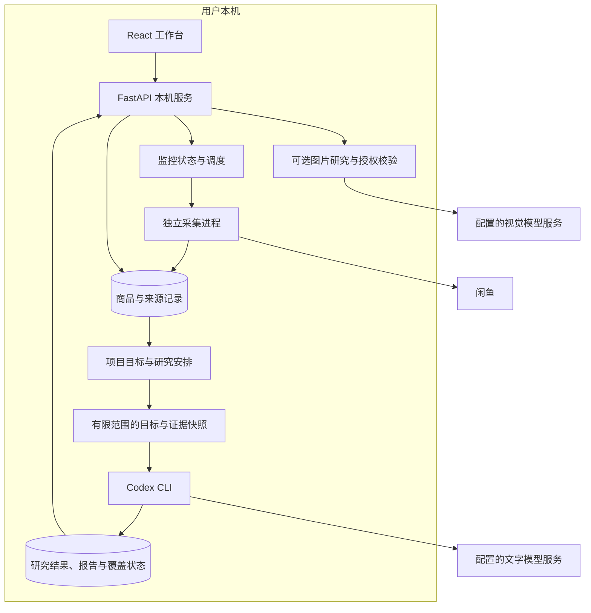

# SecondPick 系统架构

本文按当前源码说明模块边界，不代表长期稳定性或真实平台全量验收已经完成。

## 1. 运行结构

服务默认监听本机回环地址。采集、模型调用及图片请求可能访问外部服务；本地部署不等于所有数据都不离开设备。

## 2. 采集与研究解耦

监控读取已确认的关键词、模式、频率与数量范围，在环境、登录和计划允许时安排采集进程。采集结果导入本地商品库，并保存来源和执行记录。

研究基于已有商品证据和版本化目标准备自己的输入，按明确请求或已授权的调度条件运行。没有授权自动研究、也没有手动 AI 请求时，不会为了分析入库商品调用模型。

两者共享业务数据，但具有不同的状态：

| 状态 | 含义 |
| --- | --- |
| 监控允许调度 | 计划可以安排后续采集，不保证此刻正在执行 |
| 采集已保存 | 商品证据已入库，不代表符合目标或已分析 |
| 研究已安排 | 任务已排队或执行，不代表已完成 |
| 已逐项分析 | 当前版本保留了单件商品的结构化判断，不代表每个事实已独立核验 |
| 报告已生成 | 对某次输入范围形成了结论，不代表整个数据库或市场都已研究 |

## 3. 持久化与版本

- 默认商品数据库由 `config/default.toml` 的 `database_path` 指定，初始为 `data/shopping.sqlite`。
- 项目研究数据库由商品库路径派生，默认是 `data/shopping.secondpick.sqlite`，保存目标版本、研究任务、报告、候选关系等附加状态。
- 浏览器资料、图片、运行日志、设置等还使用相关本地文件目录；具体以运行配置为准。
- 修改目标会保留已有记录和旧研究上下文。已有报告不能因为目标文字改变就自动变成当前结论；监控范围也需要单独检查和确认。

这里的“共享商品库”是数据流与项目视图层面的描述，不意味着所有记录都存放在一张表或一个数据库文件中。

## 4. 模块映射

| 源码 | 职责 |
| --- | --- |
| `web/src/features/projects/` | 五个工作区、项目上下文、候选比较、统一 Agent 与目标调整 |
| `web/src/features/settings/` | 使用引导、系统服务状态与可选模型配置 |
| `src/shopping_agent/web/app.py` | API 应用与本机访问边界 |
| `src/shopping_agent/web/project_routes.py` | 项目、目标草案、研究与监控接口 |
| `src/shopping_agent/project_research.py` | 项目策略、研究安排、结果与监控窗口衔接 |
| `src/shopping_agent/monitoring.py` | 监控持久状态与运行范围 |
| `src/shopping_agent/monitor_engine.py` | 独立引擎版本检查、进程执行与结果导入 |
| `src/shopping_agent/goofish_worker.py` | 受限采集执行与平台保护信号处理 |
| `src/shopping_agent/codex_runtime.py` | 文字模型运行与结果处理 |
| `src/shopping_agent/visual_inputs.py`、`vision.py` | 图片研究输入与视觉服务相关边界 |

## 5. 模型与证据边界

文字研究通过本机配置的 Codex CLI 执行；视觉服务是可选能力，不是采集或文字研究的必要步骤。模型输入包含实际准备的目标和证据范围，不应把模型一次有限批次答复扩大为全市场结论。

视觉配置与项目图片执行分别控制。连接验证会在明确确认后发送内置测试图；项目图片分析另受具体范围审批和服务端执行开关限制。默认网页启动流程将该执行开关设为关闭，配置模型或批准范围不会自动执行图片分析。

图片已经缓存不等于 AI 已查看。图片观察不等于实物验机，卖家陈述也不等于独立证实。读取失败、执行中断、结果缺失及目标或证据变化，应保留对应状态，不能仅凭已有报告认定所有新信息都已分析。

## 6. 部署与验证边界

首次引导的 `setup_mode` 仅记录基础或 AI 增强的配置路径。基础路径检查应用、采集环境与闲鱼连接；增强路径额外检查 CLI 和账号授权，视觉模型不阻止任一路径完成。该字段不是研究权限：项目的自动研究授权与暂停状态单独管理，完成引导不会创建项目、启动监控或授权研究。

独立采集依赖外部引擎的指定版本。`monitor_engine.py` 中的 `SUPPORTED_REVISION` 为当前代码支持的提交；预检查会核对版本与源文件状态，不应通过跳过检查或任意升级引擎来消除错误。

`scripts/setup_monitor.py` 获取受支持的固定版本引擎，准备独立解释器、依赖及用户级 Chromium，不自动启动采集。它要求 Python 3.11+；Windows Python 3.12 使用随仓库提供的锁定依赖。检查通过后仅在文件不存在时创建本地配置，普通网页启动器优先读取该配置；显式配置始终优先。已有安装不会被重置，修复期间需停止服务。

启动步骤见[使用指南](user-guide.md#准备独立采集环境)，测试与隔离运行见[开发说明](DEVELOPMENT.md)。测试、截图与 GIF 应使用临时或合成数据，不能指向真实运行数据库。已完成的回归、安装检查及尚未验证的真实平台、模型和长期运行边界统一记录在[验证说明](VALIDATION.md)，本架构文档不重复维护测试统计。
